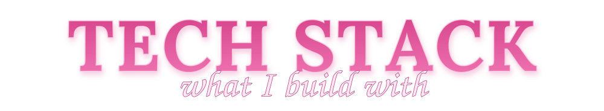

 

Hi, ich bin <b>Dein Name</b>. Ich baue gerne Dinge, die gut aussehen und sich gut anfühlen. 
Hier ein bisschen was zu mir, meinen Projekten und dem, woran ich gerade arbeite.

<table align="center">
  <tr>
    <td align="left" valign="top" width="300">
      <b>🌷 Aktuell</b> 
      Arbeite an <b>Projektname</b>
    </td>
    <td align="left" valign="top" width="300">
      <b>🫧 Lerne gerade</b> 
      TypeScript, Rust, Design Systems
    </td>
  </tr>
  <tr>
    <td align="left" valign="top" width="300">
      <b>💐 Offen für</b> 
      Zusammenarbeit an Open Source
    </td>
    <td align="left" valign="top" width="300">
      <b>🌟 Fun Fact</b> 
      Dein Fun Fact kommt hierhin
    </td>
  </tr>
</table>

<table align="center">
  <tr>
    <td align="left" valign="top" width="300">
      <a href="https://github.com/DEIN-USERNAME/projekt-eins"><b>projekt-eins</b></a> 
      Eine kurze Beschreibung, was das Projekt macht.
    </td>
    <td align="left" valign="top" width="300">
      <a href="https://github.com/DEIN-USERNAME/projekt-zwei"><b>projekt-zwei</b></a> 
      Eine kurze Beschreibung, was das Projekt macht.
    </td>
  </tr>
  <tr>
    <td align="left" valign="top" width="300">
      <a href="https://github.com/DEIN-USERNAME/projekt-drei"><b>projekt-drei</b></a> 
      Eine kurze Beschreibung, was das Projekt macht.
    </td>
    <td align="left" valign="top" width="300">
      <a href="https://github.com/DEIN-USERNAME/projekt-vier"><b>projekt-vier</b></a> 
      Eine kurze Beschreibung, was das Projekt macht.
    </td>
  </tr>
</table>

💞  Schön, dass du vorbeigeschaut hast  💞

